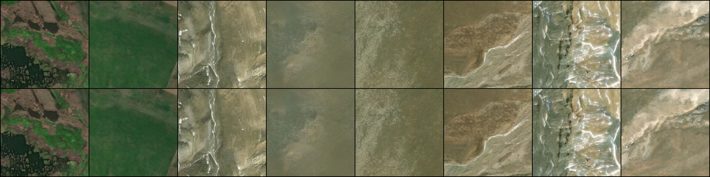
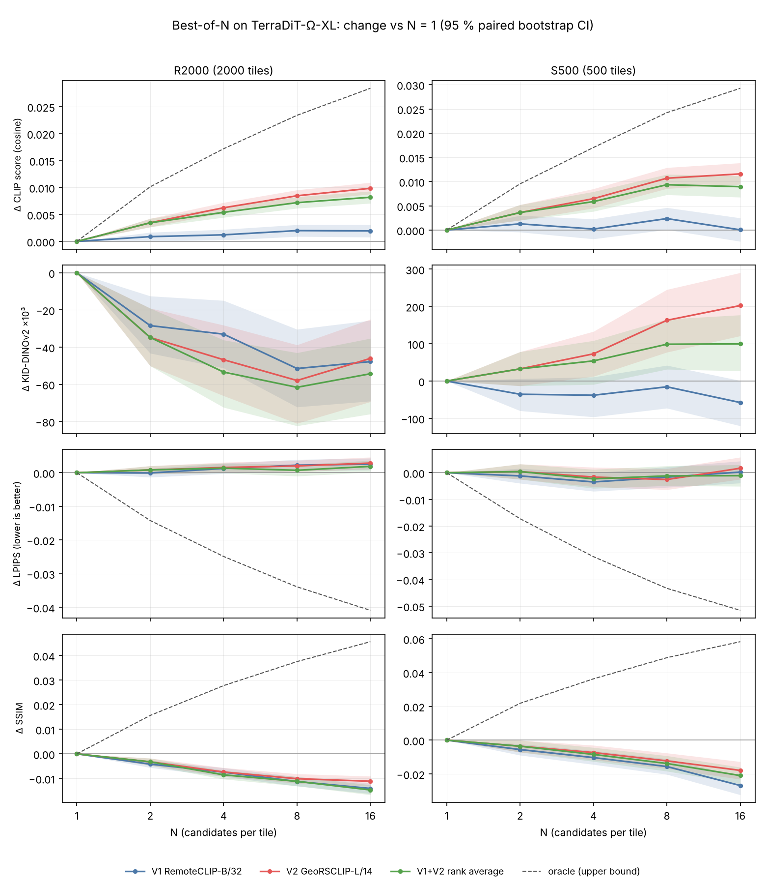

# EO-TTS: Earth Observation Test-Time Scaling

**George Plessias** ([@Redmonkeycloud](https://github.com/Redmonkeycloud)) · supervised by **Ioannis Kakogeorgiou** ([@gkakogeorgiou](https://github.com/gkakogeorgiou))

MSc thesis, MSc in Artificial Intelligence, University of Piraeus and NCSR "Demokritos"



*TerraDiT-Ω-XL, 100 Euler steps, same tiles and noise: fp32 (top) vs bf16 autocast (bottom). Mean PSNR 54.2 dB; bf16 is 1.7× faster on an RTX 3060 (6.3 vs 10.8 s per image).*

**EO-TTS** studies test-time scaling for Earth observation diffusion transformers: inference-only search
(Best-of-N, then particle-based search with Rollover Budget Forcing) over pretrained
satellite image generators, guided by remote-sensing verifiers.

## Base model

All experiments build on **TerraDiT-Ω-XL** by Wei, Sastry, Cher, Xing and Jacobs
(Multimodal Vision Research Lab, Washington University in St. Louis). Their code is pinned
here as a git submodule at commit `8d90f0d` and used unmodified.

| | Link |
| --- | --- |
| Paper (TerraDiT-Ω, ECCV 2026) | [arXiv:2606.31029](https://arxiv.org/abs/2606.31029) · [project page](https://brian-j-wei.github.io/terradit-omega/index.html) |
| Paper (TerraDiT-α/Σ) | [arXiv:2603.02172](https://arxiv.org/abs/2603.02172) · [project page](https://vishu26.github.io/terradit/index.html) |
| Code | [github.com/mvrl/TerraDiT](https://github.com/mvrl/TerraDiT) |
| Weights | [huggingface.co/MVRL/TerraDiT](https://huggingface.co/MVRL/TerraDiT) |
| Derived data and test splits | [huggingface.co/datasets/MVRL/TerraDiT-data](https://huggingface.co/datasets/MVRL/TerraDiT-data) |
| Imagery (Git-10M) | [huggingface.co/datasets/lcybuaa/Git-10M](https://huggingface.co/datasets/lcybuaa/Git-10M) |

If you use this repository, please cite their work:

```bibtex
@inproceedings{wei2026terraditomega,
  title     = {TerraDiT-{\Omega}: Unified Spatial Control for Satellite Image Synthesis with Any Geospatial Primitive},
  author    = {Wei, Brian and Sastry, Srikumar and Cher, Daniel and Xing, Eric and Jacobs, Nathan},
  booktitle = {European Conference on Computer Vision},
  year      = {2026}
}

@article{sastry2026terradit,
  title   = {TerraDiT: Point-Conditioned Diffusion Transformer for Satellite Image Synthesis},
  author  = {Sastry, Srikumar and Cher, Daniel and Wei, Brian and Dhakal, Aayush and Khanal, Subash and Gupta, Dev and Jacobs, Nathan},
  journal = {arXiv:2603.02172},
  year    = {2026}
}
```

## Status

| Stage | State |
| --- | --- |
| Paper-protocol baseline, TerraDiT-Ω-XL, Git-Rand | done: FID 9.81 vs 9.25 in the paper ([details](docs/baseline_reproduction.md)) |
| Experiment protocol for Best-of-N, fixed before any run | done ([protocol](docs/experiment_protocol.md)) |
| Pilot (Study 1), Ω-XL: Best-of-N on 2,000 Git-Rand tiles, N ∈ {1, 2, 4, 8, 16}, 2 verifiers | done: CLIP +0.0099 and KID-DINOv2 −9 % at N = 16 with GeoRSCLIP ([results](docs/bon_results.md)) |
| Pilot (Study 1), Ω-XL: Best-of-N on 500 Git-Spatial tiles (held-out region), with fp32 anchor | done: CLIP +0.0116 but KID-DINOv2 +37 %, guard fails ([results](docs/bon_results.md)) |
| Full Git-Spatial baseline | not run; Spatial is used as a held-out test set for search ([why](docs/experiment_protocol.md#anchors)) |
| Study 2 protocol: TerraDiT-Ω-B, all 14,932 Git-Rand tiles, N up to 16, FID as a primary endpoint | done, fixed before any run ([protocol v2](docs/experiment_protocol_v2.md)) |
| Study 2, anchor 1: paper-protocol baseline, TerraDiT-Ω-B, Git-Rand | done: FID 21.51 vs 21.97 in the paper's Ω-B ablation ([details](docs/baseline_reproduction.md#terradit-ω-b-on-git-rand-study-2-anchor-1)) |
| Study 2 runs: 238,912 Best-of-N samples, scoring, analysis | running (about 8 days of GPU time) |
| Rollover Budget Forcing with custom allocation rules | later |

## Baseline results

TerraDiT-Ω-XL and TerraDiT-Ω-B re-run with the authors' code and weights on the full Git-Rand
split (14,932 tiles, 100 Euler steps, no guidance, batch 32, seed 42, fp32, RTX 3060):

| Metric | Ω-XL ours | Ω-XL paper | Ω-B ours | Ω-B paper (ablation) |
| --- | --- | --- | --- | --- |
| FID ↓ | 9.81 | 9.25 | 21.51 | 21.97 |
| LPIPS ↓ | 0.3401 | 0.3438 | 0.3394 | not reported |
| SSIM ↑ | 0.2669 | 0.2665 | 0.2636 | 0.2632 |
| CLIP score (cosine) ↑ | 0.2882 | 0.2812 | 0.2828 | 0.2759 |
| KID ×10³ ↓ | 3.98 ± 0.41 | not reported | 12.16 ± 1.15 | not reported |
| Generation time | 48.3 h (11.6 s/image) | – | 15.8 h (3.81 s/image) | – |

The per-image metrics match the paper for both models. FID is 6 % higher than the paper for
Ω-XL and 2 % lower for Ω-B, and our CLIP score is 0.007 higher for both, which points to the
evaluation code rather than the samples. The Ω-B paper values come from the paper's ablation
(Table 3): it does not name the split or give LPIPS, so they are a plausibility check, not a
reproduction target. What each metric measures, what the paper leaves unstated, and the likely
reasons for the gaps are in [docs/baseline_reproduction.md](docs/baseline_reproduction.md).
Raw output: [results/baseline/omega_xl_random_omega.json](results/baseline/omega_xl_random_omega.json),
[results/baseline/omega_base_random_omega.json](results/baseline/omega_base_random_omega.json).
Each Best-of-N study is compared against the re-run of its own base model.

## Best-of-N results (pilot, Study 1: TerraDiT-Ω-XL on subsets)



On Git-Rand, picking the best of 16 samples with GeoRSCLIP raises the CLIP score by +0.0099 and
improves realism in DINOv2 feature space (KID −9 %). On the geographically held-out Git-Spatial
region, the CLIP gain is the same but realism drops (KID-DINOv2 +37 %), which the pre-registered
guard counts as a failure. Full analysis, anchors and caveats:
[docs/bon_results.md](docs/bon_results.md).

FID was added after the pilot results as an exploratory analysis (not a pre-registered
endpoint). FID at 2,000 or 500 images is biased upward, so these values are comparable only
within a set, not with the full-split values above:

| Set / verifier | N = 1 | N = 2 | N = 4 | N = 8 | N = 16 | Δ N=16 − N=1 [95 % CI] |
| --- | --- | --- | --- | --- | --- | --- |
| R2000 / V1 RemoteCLIP | 29.38 | 28.99 | 29.33 | 28.86 | 28.79 | −0.59 [−1.41, +0.03] |
| R2000 / V2 GeoRSCLIP | 29.38 | 29.05 | 29.05 | 29.41 | 29.90 | +0.51 [−0.58, +1.26] |
| R2000 / V1+V2 | 29.38 | 29.05 | 28.90 | 28.66 | 29.45 | +0.06 [−1.01, +0.77] |
| S500 / V1 RemoteCLIP | 68.83 | 68.28 | 66.29 | 66.66 | 66.73 | −2.10 [−5.57, +1.74] |
| S500 / V2 GeoRSCLIP | 68.83 | 68.15 | 66.55 | 67.48 | 68.80 | −0.03 [−3.60, +3.77] |
| S500 / V1+V2 | 68.83 | 68.15 | 66.67 | 66.52 | 66.81 | −2.02 [−6.14, +1.09] |

N = 1 is the same sample for every verifier. CIs were computed for the N = 16 comparison only
(100 tile resamples). No FID change is distinguishable from zero at these sizes, and the values
do not move steadily with N. Study 2 therefore runs on all 14,932
Git-Rand tiles, with FID as a primary endpoint ([protocol v2](docs/experiment_protocol_v2.md)).
Raw output: [results/bon/exploratory_fid.json](results/bon/exploratory_fid.json).

## Reproducing the paper baseline

The baseline calls TerraDiT's own `generate.py` and `eval/metrics.py` in-process. The only
substitution is where imagery comes from: instead of downloading all of Git-10M (394 GB,
787 shards), `Git10MSubset` keeps exactly the rows a test split uses, checked against the
split metadata by `img_name`, so pixels and captions are byte-identical.

| Split | Tiles | Git-10M shards needed | Download |
| --- | --- | --- | --- |
| random | 14,932 | 151 of 787 | 29.3 GB |
| spatial | 14,387 | 2 of 787 | 0.3 GB |

Shards are fetched one at a time and deleted after extraction; the stored subset is ~0.2 GB per split.

Paper targets (TerraDiT-Ω-XL, condition Ω, from Table 1 and Table S3 of [arXiv:2606.31029](https://arxiv.org/abs/2606.31029)) are in
`configs/paper_targets.json`; every result file stores them next to our numbers.

| Split | FID ↓ | LPIPS ↓ | SSIM ↑ | CLIP (cos) ↑ |
| --- | --- | --- | --- | --- |
| random | 9.25 | 0.3438 | 0.2665 | 0.2812 |
| spatial | 17.54 | 0.3614 | 0.3421 | 0.2761 |

Differences between the paper's stated protocol and the released code, recorded in each result:

- **Batch size:** the paper says 32, the repo defaults to 16. Noise is drawn per batch, so
  this changes individual samples, not the distribution. Use `--batch-size 32` if it fits.
- **Seed:** not reported in the paper; we use the repo default, 42.
- **CLIP:** the repo's `metrics.py` reports the CLIP logit (cosine × 100); the paper reports
  cosine. Results carry both `clip_score` and `clip_cos`.
- **sFID:** in the paper, not computed by the repo; not reported here.
- **KID:** not in the paper; added because it is unbiased on small subsets (Best-of-N).

## Setup (Windows 11, NVIDIA GPU)

```powershell
git clone --recursive https://github.com/Redmonkeycloud/eo-tts.git
cd eo-tts
conda create -n eotts python=3.11 -y
conda activate eotts
pip install torch torchvision --index-url https://download.pytorch.org/whl/cu124
pip install -e "third_party/TerraDiT[eval]"
pip install -e ".[dev]"
huggingface-cli login            # optional, avoids Hub rate limits on the 29 GB download
python scripts/00_check_env.py
```

If you cloned without `--recursive`: `git submodule update --init`.

## Run order

```powershell
python scripts/01_download_assets.py                        # omega_xl weights + test split files (~2.5 GB)
python scripts/02_build_git10m_subset.py --split spatial    # ~0.3 GB, about a minute
python scripts/03_benchmark.py                              # speed, VRAM, fp32 vs bf16 (~10 min)
python scripts/04_run_baseline.py --split spatial --limit 64   # smoke test
python scripts/02_build_git10m_subset.py --split random     # ~29 GB download, resumable
python scripts/04_run_baseline.py --split random            # the paper number (long run, resumable)
python scripts/04_run_baseline.py --split spatial
```

Generation resumes from the images already on disk, so an interrupted run is restarted with
the same command. Results land in `runs/baseline/<run>/results.json`.

## Best-of-N run order

Fixed in advance by [docs/experiment_protocol.md](docs/experiment_protocol.md). GPU hours are on an RTX 3060.

```powershell
python scripts/05_generate_bon.py --set S500 --limit-tiles 2        # smoke test, a few minutes
python scripts/05_generate_bon.py --set R2000                       # 32,000 samples, bf16, ~56 h
python scripts/05_generate_bon.py --set S500                        # 8,000 samples, bf16, ~14 h
python scripts/05_generate_bon.py --set S500 --anchor-fp32          # sample 0 in fp32, same noise, ~1.6 h
python scripts/06_score_bon.py --run R2000
python scripts/06_score_bon.py --run S500
python scripts/06_score_bon.py --run S500_fp32_k0
python scripts/06_score_bon.py --run R2000_baseline_fp32            # the fp32 baseline images on R2000 (anchors 1-2)
python scripts/07_analyze_bon.py                                    # -> results/bon/report.md
python scripts/08_plot_bon.py                                       # -> docs/assets/bon_scaling.png
```

Study 2 ([protocol v2](docs/experiment_protocol_v2.md)): TerraDiT-Ω-B on all of Git-Rand.

```powershell
python scripts/01_download_assets.py --models omega_base
python scripts/04_run_baseline.py --model omega_base --split random --batch-size 32   # anchor 1, fp32, ~16 h
python scripts/05_generate_bon.py --set RFULL --model omega_base                        # 238,912 samples, bf16, ~180 h
python scripts/05_generate_bon.py --set RFULL --model omega_base --anchor-fp32 --anchor-tiles 500   # anchor 3
python scripts/06_score_bon.py --run RFULL_omega_base
python scripts/06_score_bon.py --run RFULL_omega_base_fp32_k0
python scripts/06_score_bon.py --run RFULL_omega_base_baseline_fp32                     # anchor 2
python scripts/10_analyze_v2.py --check-gpu-kid                                          # GPU KID vs the pilot numbers
python scripts/10_analyze_v2.py                                                          # -> results/bon_v2/report.md
```

Every step resumes after an interruption. Each sample has its own seed, derived from
(split, tile, sample index), so a sample is identical however and whenever it is generated.

## Layout

```
configs/paper_targets.json      paper numbers we compare against
docs/baseline_reproduction.md   baseline results, metric definitions, gap analysis
docs/experiment_protocol.md     Best-of-N questions, tiles, verifiers, endpoints, statistics (pre-registered)
docs/bon_results.md             Best-of-N results, anchors, interpretation, caveats (pilot, Study 1)
docs/experiment_protocol_v2.md  Study 2: Ω-B on all of Git-Rand, FID + CLIP primary (pre-registered)
configs/subsets/                fixed evaluation tile lists and their representativeness statistics
eotts/data/subsets.py           how the subsets are drawn and checked
eotts/bon/                      Best-of-N: sets and seeds, generation, selection rules, analysis, report
eotts/scoring/                  verifiers (V1, V2) and evaluators (E1-E5)
eotts/stats/                    KID from features, paired bootstrap, Holm
results/                        result files of finished runs (images stay local)
eotts/data/git10m_subset.py     exact local subset of Git-10M (shard math, verify, read)
eotts/baselines/                paper-protocol baseline runner
eotts/eval/kid.py               KID (extra metric for small subsets)
eotts/provenance.py             code versions, environment, GPU, written into every result
scripts/00..08                  the steps above, in order
third_party/TerraDiT            upstream code, pinned, unmodified
tests/                          subset builder, statistics and selection tests (no GPU, no network)
```

## Licences

Code licence for this repo: to be decided. TerraDiT code is Apache-2.0; its weights are CC-BY-NC-4.0 and Git-10M imagery
is CC-BY-NC-ND-4.0, so this work is non-commercial research only. Git-10M data is never
redistributed by this repo; it is downloaded from the original repository.
