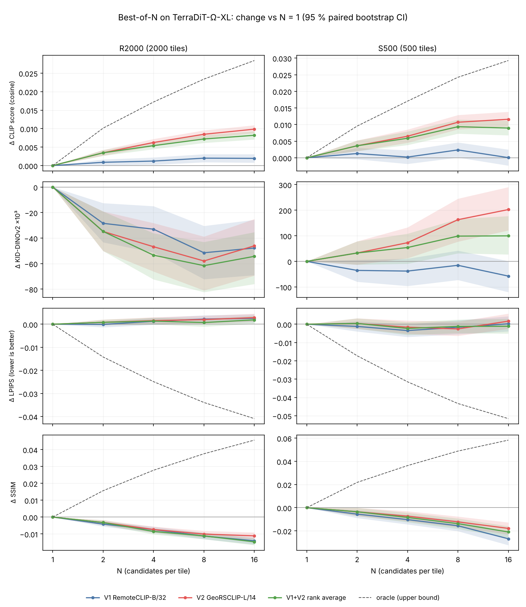

# Best-of-N results: TerraDiT-Ω-XL on Git-Rand and Git-Spatial

Results of the experiments fixed in advance by [experiment_protocol.md](experiment_protocol.md)
(version 1 with amendments 1 and 2, all committed before the analysis ran).

On randomly drawn Git-Rand tiles, Best-of-N selection with the GeoRSCLIP verifier raises the CLIP
score by +0.0099 at N = 16 and makes the images more realistic by the independent DINOv2 KID
(−9 %). On the geographically held-out Git-Spatial region, the same selection raises the CLIP score
as much (+0.0116) but makes the images markedly **less** realistic (KID-DINOv2 +37 %). Under the
protocol that is a failure of the method on that set. The weaker RemoteCLIP verifier gives a small
gain on Git-Rand and none on Git-Spatial.

Raw numbers: [`results/bon/`](../results/bon/) (`report.md` is the full table; `R2000.json`,
`S500.json`, `endpoints.json`, `anchors.json` hold every estimate with its CI). The figure is drawn
by `scripts/08_plot_bon.py` from those files.

## Setup, in one paragraph

2,000 Git-Rand tiles (R2000) and 500 Git-Spatial tiles (S500), drawn by a seeded permutation and
listed in `configs/subsets/`. For each tile, 16 samples were generated with TerraDiT-Ω-XL (100 Euler
steps, no guidance, all conditioning, bf16), each with its own seed. BoN-N picks one of samples
0 … N−1, so all N share the same samples and every comparison is paired by tile. Verifiers select:
V1 RemoteCLIP ViT-B/32, V2 GeoRSCLIP ViT-L/14, and their rank average. Evaluators never select:
CLIP ViT-L/14 (E1), LPIPS (E2) and SSIM (E3) against the tile's ground truth, and KID on Inception
(E4) and DINOv2 (E5) features. CIs are 95 % paired bootstrap over tiles.

## Anchors: the measurement is sound

All four checks passed, and the stop rule was not triggered.

| Anchor | Result |
| --- | --- |
| 1. R2000 represents Git-Rand | fp32 baseline images on the 2,000 tiles: CLIP 0.2887, LPIPS 0.3388, SSIM 0.2646. Each CI contains the full-split value (0.2882, 0.3401, 0.2669). |
| 2. bf16 vs fp32, R2000 (different noise) | Differences +0.0002 CLIP, −0.0006 LPIPS, +0.0005 SSIM. All CIs contain 0. |
| 3. bf16 vs fp32, S500 (same noise) | Mean PSNR 50.4 dB (5th pct. 43.5, minimum 27.5). CLIP and LPIPS differ by < 0.0001. SSIM differs by +0.0003: significant, but 60× smaller than the Best-of-N effects on SSIM. |
| 4. S500 vs the paper's Git-Spatial values | LPIPS and SSIM inside the CI. CLIP is 0.0055 higher. Our Git-Rand baseline is also 0.007 higher than the paper (see [baseline_reproduction.md](baseline_reproduction.md)), so this is the same implementation offset, not a property of the samples. |

## Primary endpoints

CLIP score (E1), N = 16 vs N = 1, Holm-corrected over the six verifier × set tests. Guard:
KID-DINOv2 (E5) at N = 16 must be non-inferior to N = 1, with the upper CI bound below 10 % of
KID at N = 1.

| Set / verifier | Δ CLIP [95 % CI] | p (Holm) | Δ KID-DINOv2 ×10³ [95 % CI] | Relative | Guard |
| --- | --- | --- | --- | --- | --- |
| R2000 / V1 | +0.0020 [+0.0008, +0.0031] | 0.0006 | −47.8 [−69.0, −25.7] | −9.8 % | pass |
| R2000 / V2 | +0.0099 [+0.0088, +0.0109] | 0.0006 | −46.1 [−69.4, −25.0] | −9.5 % | pass |
| R2000 / V1+V2 | +0.0082 [+0.0071, +0.0093] | 0.0006 | −54.3 [−76.0, −35.3] | −11.2 % | pass |
| S500 / V1 | +0.0000 [−0.0023, +0.0025] | 0.98 | −57.6 [−120.2, +1.1] | −10.6 % | pass |
| S500 / V2 | +0.0116 [+0.0094, +0.0139] | 0.0006 | +202.4 [+121.1, +290.4] | +37.2 % | **fail** |
| S500 / V1+V2 | +0.0090 [+0.0068, +0.0112] | 0.0006 | +99.6 [+27.1, +177.1] | +18.3 % | **fail** |

p = 0.0006 is the floor of a 10,000-resample bootstrap after Holm (6 × 1/10,000). KID at N = 1:
0.487 on R2000, 0.544 on S500.

**Q1, does selection help, and how does it scale?** On R2000, yes, for every verifier. With V2,
the CLIP gain is +0.0035, +0.0062, +0.0085 and +0.0099 at N = 2, 4, 8 and 16: it grows with every
doubling, by less each time. For scale, the paper's CLIP gap between TerraDiT-α-XL and
TerraDiT-Σ-XL is 0.0090. The oracle, which picks the best of N by the CLIP evaluator itself,
reaches +0.0284 at N = 16, so V2 recovers about 35 % of what selection among 16 samples could
give on this metric.

**Q2, does the gain depend on the verifier and transfer to unseen metrics?** It depends strongly
on the verifier. V2 gives five times the CLIP gain of V1 on R2000. On R2000 the gain transfers to
the independent realism metric: KID-DINOv2 falls by about 10 % for all three rules. KID-Inception
falls significantly for V1 (−0.65 ×10³, −16 %) and changes insignificantly for V2. Part of V2's CLIP
gain is expected from shared ancestry, since V2 and the evaluator are both ViT-L/14 CLIP models
(within-tile Spearman 0.31). The DINOv2 result does not depend on that relation.

**Q3, is the gain different on held-out geography?** The CLIP gain is similar: +0.0116 for V2 on
S500 against +0.0099 on R2000. The effect on realism reverses. With V2, KID-DINOv2 rises with every
doubling of N (+33, +73, +163, +202 ×10³), and at N = 16 the guard fails. We expected search to help
more where the base model is weaker. Instead, on the held-out region, choosing the sample that best
matches the caption moves the selected images away from the real image distribution.

## Secondary findings

**Fidelity to the specific ground-truth image decreases.** SSIM falls for every rule on both sets,
by −0.011 to −0.015 on R2000 and −0.018 to −0.027 on S500 at N = 16. LPIPS rises slightly on R2000
(+0.002 to +0.003) and does not change significantly on S500. Within a tile, both verifiers are
negatively correlated with SSIM (Spearman −0.15 to −0.27). Selection for caption agreement is not
selection for resemblance to the one real image the caption was written for. The oracle shows how
much room there is on these metrics (SSIM +0.046 at N = 16 on R2000), and that room is not what
the verifiers pick up.

**The verifiers are weaker on S500.** On the real tiles, we measured the share of the set's other
captions that a verifier ranks above the tile's own caption (0 = always first, 0.5 = chance). V2
scores 0.033 on R2000 and 0.103 on S500. V1 scores 0.084 and 0.198. Spatial tiles are visually
homogeneous (narrow longitude band, 2.4 OSM instances per tile against 10.8 on Git-Rand), and their
captions are similar. This likely explains V1's null result on S500. It may also contribute to V2's
loss of realism there, through selection on a noisier signal. That second point is a hypothesis.

**No position bias.** At every N, the selected sample index is spread evenly over 0 … N−1, as it
should be with independent seeds (`selected_index_hist` in the JSON files).

## Caveats

- S500 is a single held-out region, with a longitude standard deviation of 1.3°, and has 500
  tiles. Its KID CIs are wide, though the V2 interval excludes 0 by a large margin. A second
  held-out region would be needed to call the S500 result a general property of held-out
  geography.
- The S500 subset KID values in `anchors.json` and `S500.json` (`n1_kid_subsets`) report
  `kid_std ≈ 0`. With 500 tiles, every 500-tile "subset" is the whole set, so that standard deviation
  carries no information. The bootstrap CIs above are the uncertainty to use.
- Two text-alignment verifiers only. The structural verifier for the geometry primitives (V3) is
  not part of this run.
- One base model. All results are for TerraDiT-Ω-XL.

## Compute

RTX 3060 12 GB. Generation: 7.44 s per image in bf16 (benchmark: 6.33 s; the difference is VAE
decoding, PNG writing and data loading, which the benchmark did not time). R2000 took about 66 h
and S500 about 17 h. Scoring of R2000 took about 4.5 h, of which 3.6 h were LPIPS, SSIM and CLIP
(E1–E3). Generation records, with the code commit and software versions at start, are in
`results/bon/generation/`.

## Next

1. **Post-hoc analysis of S500, labelled as such.** Is the KID-DINOv2 increase spread over tiles or
   driven by a few? Does it relate to empty tiles or caption type? What do the selected images look
   like next to sample 0?
2. **Final full-split run** (protocol): V2 at N = 4 on all of Git-Rand, for a FID comparable to the
   baseline (9.81) and the paper (9.25). The R2000 tiles already have samples 0–3 under the same
   seeds and are reused.
3. **Search with verifier-aware compute allocation (Rollover Budget Forcing).** The S500 result
   makes this question sharper. Search should spend its budget where the verifier is reliable and
   hold back where it is not.
