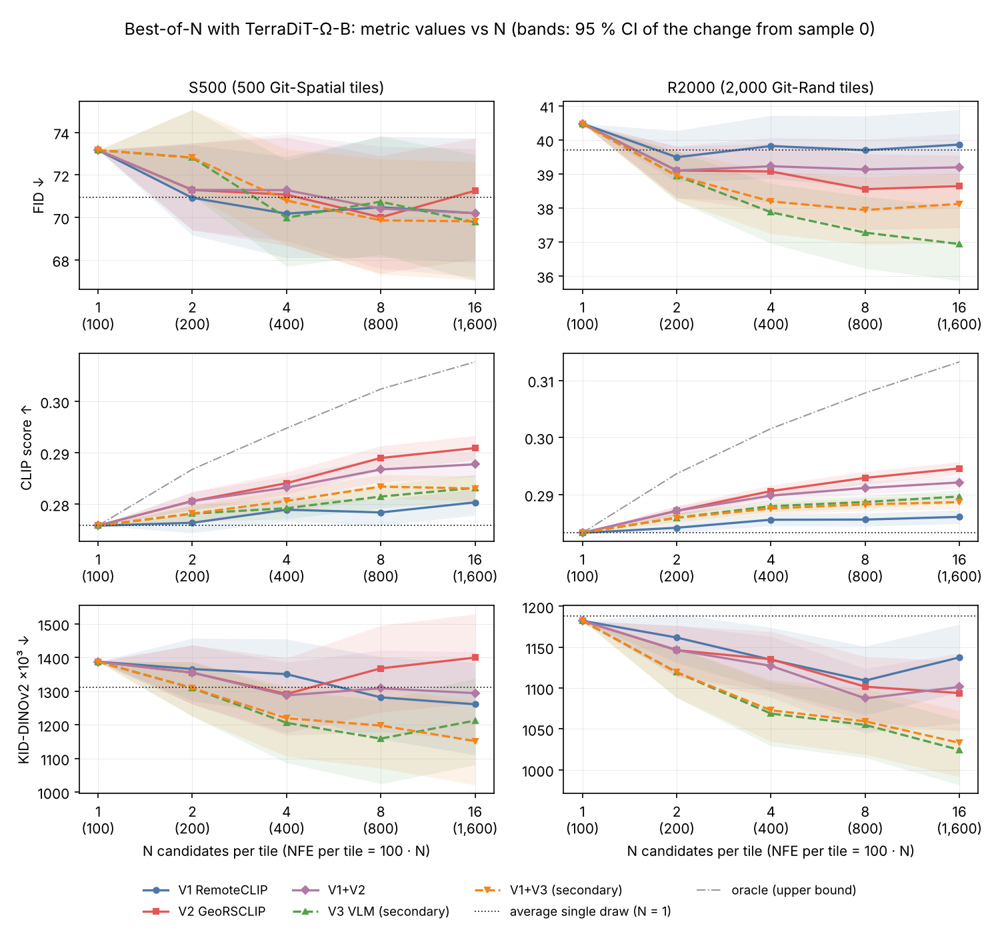
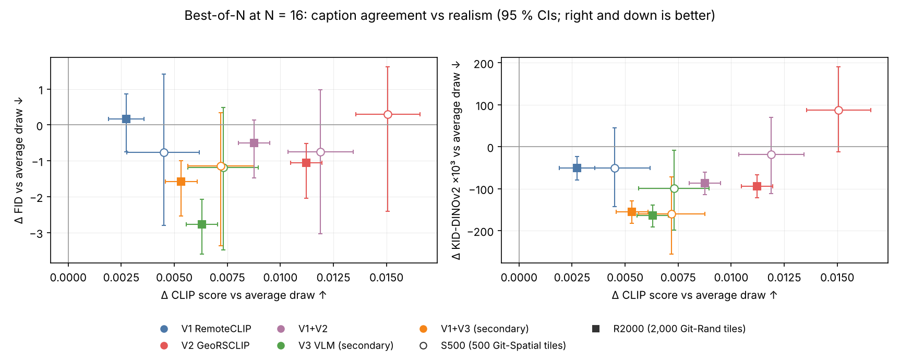
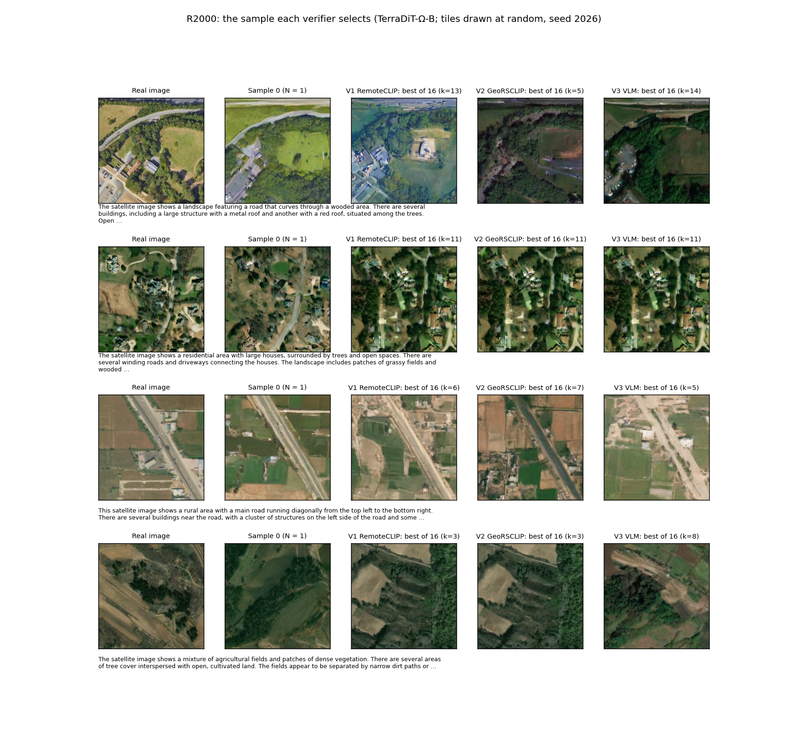
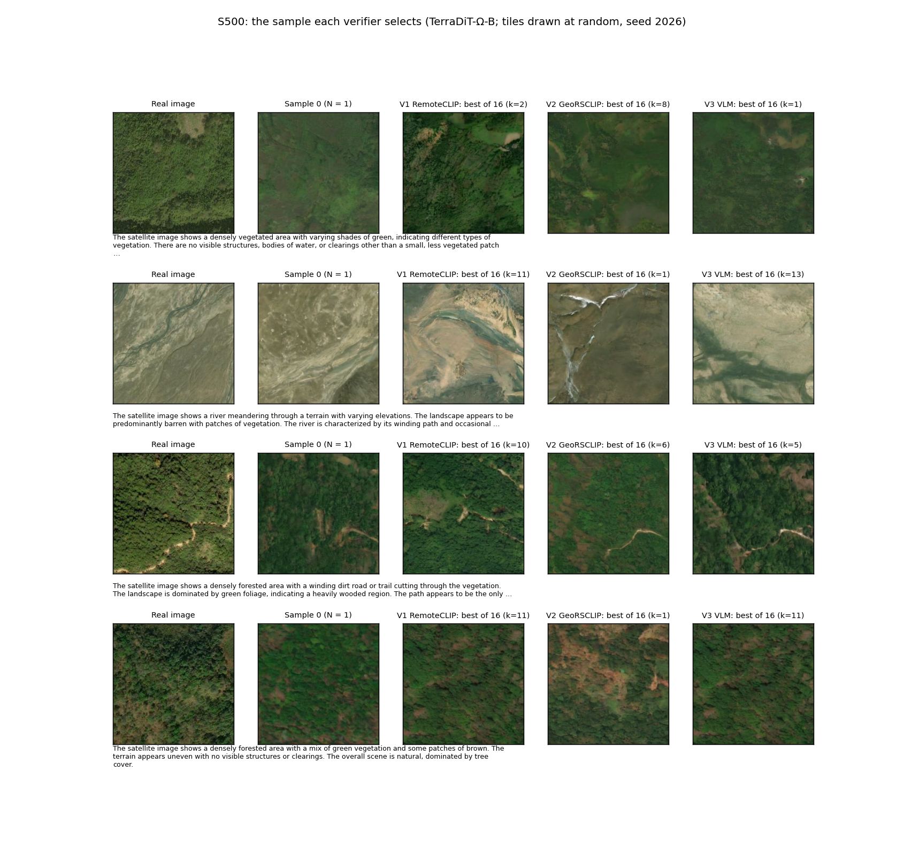

# Study 2, interim results: TerraDiT-Ω-B on S500 and R2000

Results of Study 2 ([experiment_protocol_v2.md](experiment_protocol_v2.md), amendments 1–3) on
the two subsets. The main set, all 14,932 Git-Rand tiles (RFULL), is being generated; its
results will be added here. Raw numbers: [`results/bon_v2/`](../results/bon_v2/)
(`report_S500.md` and `report_R2000.md` hold every cell with its CI).

**In short.** All three primary verifiers raise the CLIP score on both sets. Measured against
the average single draw (amendment 3), the VLM verifier V3 (InternVL3-2B, P("yes")) improves
realism far more than any CLIP-based verifier: on R2000 it lowers FID by 2.8 and KID-DINOv2 by
14 % at N = 16, and it costs the least fidelity to the ground-truth image. V2 (GeoRSCLIP) gives
the largest CLIP gain but, on the held-out region S500, makes images less realistic by
KID-Inception, as Ω-XL did in the pilot. V1 (RemoteCLIP) gives a small, consistent CLIP gain
and leaves realism unchanged.

## Setup

| | |
| --- | --- |
| Model | TerraDiT-Ω-B (released weights), 100 Euler steps, no guidance, bf16 |
| Sets | S500: 500 Git-Spatial tiles (held-out region); R2000: 2,000 Git-Rand tiles. Same tiles and seeds as the pilot |
| Samples | 16 per tile, independent seeds; Best-of-N picks one of samples 0 … N−1, N ∈ {1, 2, 4, 8, 16} |
| Compute | 100 Euler steps, CFG 0: 100 NFE per sample, 100 · N NFE per tile (see Compute below) |
| Primary verifiers | V1 RemoteCLIP ViT-B/32, V2 GeoRSCLIP ViT-L/14, V1+V2 rank average |
| Secondary verifiers | V3 InternVL3-2B, P("yes") to "Does this figure show {caption}?" (amendment 2); V1+V3 rank average |
| Evaluators | CLIP ViT-L/14 score, LPIPS and SSIM vs the tile's real image, FID, KID-Inception, KID-DINOv2 |
| Statistics | 95 % paired tile bootstrap (10,000 resamples per-image metrics, 1,000 FID/KID); Holm over CLIP and FID × 3 primary rules per set |

FID on 500 or 2,000 images is biased upward. Compare FID values only within a set, never with
the full-split baseline (21.51) or the paper.

## Checks on the measurement

| Check | Result |
| --- | --- |
| KID on GPU (float32) vs the float64 pilot numbers | worst deviation 0.025 % of a CI width (threshold 1 %): pass |
| bf16 vs fp32, same noise (anchor 3) | PSNR 51.0 dB (S500), 47.1 dB (R2000); CLIP, LPIPS, SSIM differ by ≤ 0.0004 |
| BoN sample 0 vs fp32 baseline, different noise (anchor 2, R2000) | CLIP, LPIPS, SSIM equal; FID 40.47 vs 39.35: **stop rule triggered** (report 1) |

**Why the stop rule triggered.** The N = 1 reference is sample 0. Taking sample k of every tile
gives 16 independent draws of the whole set from the same model (post-hoc diagnostic,
`results/bon_v2/null_draws.md`):

| Run | FID over the 16 draws, mean ± SD | Range | FID of sample 0 |
| --- | --- | --- | --- |
| R2000, Ω-B | 39.70 ± 0.34 | 39.17 – 40.47 | **40.47** (highest) |
| S500, Ω-B | 70.96 ± 0.95 | 69.75 – 73.17 | **73.17** (highest) |
| R2000, Ω-XL (pilot) | 29.32 ± 0.28 | 28.75 – 29.69 | 29.38 (ordinary) |
| S500, Ω-XL (pilot) | 68.94 ± 0.87 | 67.72 – 70.80 | 68.83 (ordinary) |

The fp32 baseline (39.35) is an ordinary draw; sample 0 is not. Sample 0 is ordinary on every
per-image score, verifier score and simple image statistic (`results/bon_v2/sample0_check.md`),
and it reproduces under another batch layout and in fp32, so no defect in generation or scoring
was found. Because a single draw is a noisy reference for set-level metrics, amendment 3 adds
the **average single draw** as a second reference. For S500 and R2000 that reference is
post-hoc; for RFULL it was fixed before the analysis.

## Compute: NFE

Sampler: the authors' `euler_sampler`, 100 steps, CFG scale 0 (`heun=False`), so one forward
pass of the denoiser per step and no unconditional pass: **100 NFE per sample**. Best-of-N with
N candidates costs **100 · N NFE per tile** (the samples are independent; nothing is shared).

| N (candidates per tile) | 1 | 2 | 4 | 8 | 16 |
| --- | --- | --- | --- | --- | --- |
| NFE per tile (denoiser forward passes) | 100 | 200 | 400 | 800 | 1,600 |
| VAE decodes per tile | 1 | 2 | 4 | 8 | 16 |
| Verifier calls per tile | – | 2 | 4 | 8 | 16 |
| Generation time per tile, Ω-B, bf16, RTX 3060 (measured 2.86 s per image) | 2.9 s | 5.7 s | 11.4 s | 22.9 s | 45.7 s |

Not counted in NFE: N VAE decodes (inside the measured generation time) and N verifier calls.
Measured: generation 2.86 s per image (S500), 2.88 s (R2000), 2.95 s (RFULL, with CPU analysis
running alongside); V3 scoring 1.5 s per tile of 16 samples (about 0.09 s per image). NFE is the
budget unit for comparing search algorithms with Best-of-N in the next stage.

## Figures

FID, CLIP score and KID-DINOv2 of the selected images as N grows (bands: 95 % CI of the change
from sample 0; dotted: the average single draw). Drawn by `scripts/16_plot_v2.py`.

Each point is one verifier on one set at N = 16, against the average single draw: further right
is better caption agreement, further down is more realistic. V2 sits furthest right, V3 lowest.

Tiles drawn at random (seed 2026) by `scripts/17_examples_v2.py`: the real image, sample 0 and
the best of 16 by V1, V2 and V3.

## Metric values at N = 16

Generated from `results/bon_v2/<set>.json` by `scripts/15_tables_v2.py` (also written to
`results/bon_v2/tables.md`). The differences with CIs follow in Results 1–3.

**R2000 (2,000 Git-Rand tiles)**

| Selection | CLIP ↑ | LPIPS ↓ | SSIM ↑ | FID ↓ | KID-Inception ×10³ ↓ | KID-DINOv2 ×10³ ↓ |
| --- | --- | --- | --- | --- | --- | --- |
| N = 1: sample 0 (registered reference) | 0.2833 | 0.3378 | 0.2613 | 40.47 | 12.67 | 1182.3 |
| N = 1: average single draw (amendment 3) | 0.2834 | 0.3383 | 0.2603 | 39.70 | 11.84 | 1188.2 |
| N = 16: V1 RemoteCLIP | 0.2861 | 0.3405 | 0.2483 | 39.86 | 12.10 | 1137.5 |
| N = 16: V2 GeoRSCLIP | 0.2946 | 0.3389 | 0.2507 | 38.64 | 11.22 | 1093.9 |
| N = 16: V1+V2 | 0.2921 | 0.3385 | 0.2476 | 39.19 | 11.29 | 1101.4 |
| N = 16: V3 VLM (secondary) | 0.2897 | 0.3367 | 0.2566 | 36.94 | 9.53 | 1024.3 |
| N = 16: V1+V3 (secondary) | 0.2887 | 0.3381 | 0.2524 | 38.12 | 10.48 | 1033.0 |
| N = 16: oracle (upper bound, picks by the evaluator itself) | 0.3132 | 0.2992 | 0.3074 | – | – | – |

**S500 (500 Git-Spatial tiles, held-out region)**

| Selection | CLIP ↑ | LPIPS ↓ | SSIM ↑ | FID ↓ | KID-Inception ×10³ ↓ | KID-DINOv2 ×10³ ↓ |
| --- | --- | --- | --- | --- | --- | --- |
| N = 1: sample 0 (registered reference) | 0.2758 | 0.3479 | 0.3339 | 73.17 | 15.64 | 1387.4 |
| N = 1: average single draw (amendment 3) | 0.2759 | 0.3479 | 0.3315 | 70.96 | 13.00 | 1312.1 |
| N = 16: V1 RemoteCLIP | 0.2804 | 0.3487 | 0.3109 | 70.20 | 12.43 | 1260.8 |
| N = 16: V2 GeoRSCLIP | 0.2909 | 0.3477 | 0.3185 | 71.25 | 16.04 | 1399.6 |
| N = 16: V1+V2 | 0.2878 | 0.3478 | 0.3101 | 70.20 | 14.07 | 1293.9 |
| N = 16: V3 VLM (secondary) | 0.2832 | 0.3427 | 0.3280 | 69.77 | 13.57 | 1212.4 |
| N = 16: V1+V3 (secondary) | 0.2831 | 0.3438 | 0.3176 | 69.81 | 13.25 | 1151.4 |
| N = 16: oracle (upper bound, picks by the evaluator itself) | 0.3077 | 0.3019 | 0.3926 | – | – | – |

## Result 1: registered primary endpoints (N = 16 vs sample 0)

| Set | Verifier | Δ CLIP [95 % CI] | Δ FID [95 % CI] | Guard: Δ KID-DINOv2 ×10³ [95 % CI] (margin) | Verdict |
| --- | --- | --- | --- | --- | --- |
| R2000 | V1 | **+0.0028** [+0.0016, +0.0040] | −0.61 [−1.77, +0.41] | −44.8 [−87.7, −4.3] (118.2): pass | improvement |
| R2000 | V2 | **+0.0113** [+0.0102, +0.0124] | **−1.83** [−3.06, −0.93] | −88.4 [−135.2, −49.2]: pass | improvement |
| R2000 | V1+V2 | **+0.0088** [+0.0077, +0.0100] | **−1.28** [−2.46, −0.29] | −80.9 [−124.8, −39.6]: pass | improvement |
| S500 | V1 | **+0.0045** [+0.0020, +0.0071] | −2.97 [−5.30, +0.56] | −126.6 [−277.3, −1.9] (138.7): pass | improvement |
| S500 | V2 | **+0.0151** [+0.0127, +0.0175] | −1.91 [−5.13, +0.58] | +12.1 [−122.8, +141.7]: **fail** | not an improvement |
| S500 | V1+V2 | **+0.0119** [+0.0095, +0.0143] | −2.97 [−5.97, +0.07] | −93.5 [−231.8, +29.3]: pass | improvement |

Bold: significant after Holm (all CLIP p_Holm ≤ 0.0008; FID p_Holm 0.003 for V2 and 0.032 for
V1+V2 on R2000, ≥ 0.19 elsewhere). An improvement needs a significant CLIP gain, no
significant FID increase and a passed guard. On R2000 these FID differences are measured from
the unusually poor sample 0 (stop rule), so Result 2 is the more reliable reading of FID and KID.

## Result 2: N = 16 vs the average single draw (amendment 3)

| Set | Verifier | Δ CLIP | Δ FID | Δ KID-Inception ×10³ | Δ KID-DINOv2 ×10³ |
| --- | --- | --- | --- | --- | --- |
| R2000 | V1 | **+0.0027** [+0.0019, +0.0036] | +0.16 [−0.75, +0.86] | +0.25 [−0.40, +0.93] | **−50.7** [−78.9, −22.9] |
| R2000 | V2 | **+0.0112** [+0.0105, +0.0120] | **−1.06** [−2.04, −0.53] | −0.62 [−1.21, +0.05] | **−94.3** [−121.9, −67.0] |
| R2000 | V1+V2 | **+0.0088** [+0.0080, +0.0095] | −0.51 [−1.48, +0.13] | −0.55 [−1.18, +0.07] | **−86.8** [−114.5, −61.3] |
| R2000 | V3 (secondary) | **+0.0063** [+0.0056, +0.0070] | **−2.77** [−3.59, −2.08] | **−2.31** [−2.87, −1.71] | **−163.9** [−191.5, −138.5] |
| R2000 | V1+V3 (secondary) | **+0.0053** [+0.0046, +0.0061] | **−1.58** [−2.54, −1.00] | **−1.36** [−2.00, −0.75] | **−155.2** [−182.3, −128.7] |
| S500 | V1 | **+0.0045** [+0.0028, +0.0062] | −0.76 [−2.80, +1.41] | −0.57 [−1.91, +0.79] | −51.3 [−143.0, +45.1] |
| S500 | V2 | **+0.0150** [+0.0136, +0.0166] | +0.30 [−2.41, +1.62] | **+3.04** [+1.51, +4.68] (worse) | +87.5 [−12.0, +190.8] |
| S500 | V1+V2 | **+0.0119** [+0.0103, +0.0134] | −0.76 [−3.04, +0.98] | +1.07 [−0.32, +2.58] | −18.2 [−111.4, +69.8] |
| S500 | V3 (secondary) | **+0.0073** [+0.0056, +0.0090] | −1.19 [−3.49, +0.49] | +0.57 [−0.88, +1.93] | **−99.7** [−198.4, −9.1] |
| S500 | V1+V3 (secondary) | **+0.0072** [+0.0056, +0.0088] | −1.14 [−3.36, +0.34] | +0.25 [−1.08, +1.61] | **−160.7** [−255.3, −72.5] |

Bold: the 95 % CI excludes 0 (no multiplicity correction; secondary analysis). Lower FID and
KID are better. KID-DINOv2 of the average draw: 1,188 ×10³ on R2000, 1,312 ×10³ on S500.

## Result 3: fidelity to the real image (N = 16 vs sample 0)

| Set | Verifier | Δ LPIPS (lower is better) | Δ SSIM (higher is better) |
| --- | --- | --- | --- |
| R2000 | V1 | +0.0026 [+0.0010, +0.0043] | −0.0130 [−0.0150, −0.0110] |
| R2000 | V2 | +0.0011 [−0.0006, +0.0028] | −0.0106 [−0.0126, −0.0085] |
| R2000 | V1+V2 | +0.0006 [−0.0010, +0.0022] | −0.0137 [−0.0156, −0.0117] |
| R2000 | V3 | −0.0011 [−0.0028, +0.0005] | **−0.0047** [−0.0065, −0.0027] |
| R2000 | V1+V3 | +0.0003 [−0.0013, +0.0019] | −0.0088 [−0.0108, −0.0069] |
| S500 | V1 | +0.0008 [−0.0032, +0.0048] | −0.0230 [−0.0283, −0.0177] |
| S500 | V2 | −0.0002 [−0.0035, +0.0032] | −0.0154 [−0.0203, −0.0104] |
| S500 | V1+V2 | −0.0001 [−0.0039, +0.0036] | −0.0237 [−0.0288, −0.0186] |
| S500 | V3 | **−0.0052** [−0.0086, −0.0019] | **−0.0059** [−0.0109, −0.0009] |
| S500 | V1+V3 | **−0.0041** [−0.0076, −0.0006] | −0.0162 [−0.0211, −0.0111] |

Every verifier lowers SSIM: choosing for agreement with the caption is not choosing for
resemblance to the one real image. V3 loses the least SSIM on both sets and is the only
verifier that significantly improves LPIPS (on S500). Sample 0 is ordinary on LPIPS and SSIM,
so this table needs no second reference.

## Result 4: metric values at every N

N = 1 is sample 0. The average single draw is 39.70 FID on R2000 and 70.96 on S500.

**FID ↓, R2000**

| Verifier | N = 1 | N = 2 | N = 4 | N = 8 | N = 16 |
| --- | --- | --- | --- | --- | --- |
| V1 RemoteCLIP | 40.47 | 39.49 | 39.82 | 39.70 | 39.86 |
| V2 GeoRSCLIP | 40.47 | 39.10 | 39.07 | 38.55 | 38.64 |
| V1+V2 | 40.47 | 39.10 | 39.22 | 39.13 | 39.19 |
| V3 VLM (secondary) | 40.47 | 38.94 | 37.87 | 37.27 | 36.94 |
| V1+V3 (secondary) | 40.47 | 38.94 | 38.19 | 37.94 | 38.12 |

**FID ↓, S500**

| Verifier | N = 1 | N = 2 | N = 4 | N = 8 | N = 16 |
| --- | --- | --- | --- | --- | --- |
| V1 RemoteCLIP | 73.17 | 70.92 | 70.18 | 70.48 | 70.20 |
| V2 GeoRSCLIP | 73.17 | 71.29 | 71.07 | 70.00 | 71.25 |
| V1+V2 | 73.17 | 71.29 | 71.28 | 70.42 | 70.20 |
| V3 VLM (secondary) | 73.17 | 72.81 | 69.98 | 70.74 | 69.77 |
| V1+V3 (secondary) | 73.17 | 72.81 | 70.79 | 69.86 | 69.81 |

**CLIP score ↑, R2000**

| Verifier | N = 1 | N = 2 | N = 4 | N = 8 | N = 16 |
| --- | --- | --- | --- | --- | --- |
| V1 RemoteCLIP | 0.2833 | 0.2842 | 0.2856 | 0.2856 | 0.2861 |
| V2 GeoRSCLIP | 0.2833 | 0.2872 | 0.2906 | 0.2929 | 0.2946 |
| V1+V2 | 0.2833 | 0.2872 | 0.2898 | 0.2912 | 0.2921 |
| V3 VLM (secondary) | 0.2833 | 0.2859 | 0.2880 | 0.2887 | 0.2897 |
| V1+V3 (secondary) | 0.2833 | 0.2859 | 0.2876 | 0.2883 | 0.2887 |

**CLIP score ↑, S500**

| Verifier | N = 1 | N = 2 | N = 4 | N = 8 | N = 16 |
| --- | --- | --- | --- | --- | --- |
| V1 RemoteCLIP | 0.2758 | 0.2764 | 0.2790 | 0.2784 | 0.2804 |
| V2 GeoRSCLIP | 0.2758 | 0.2806 | 0.2841 | 0.2890 | 0.2909 |
| V1+V2 | 0.2758 | 0.2806 | 0.2832 | 0.2868 | 0.2878 |
| V3 VLM (secondary) | 0.2758 | 0.2782 | 0.2792 | 0.2815 | 0.2832 |
| V1+V3 (secondary) | 0.2758 | 0.2782 | 0.2806 | 0.2834 | 0.2831 |

**KID-DINOv2 ×10³ ↓, R2000**

| Verifier | N = 1 | N = 2 | N = 4 | N = 8 | N = 16 |
| --- | --- | --- | --- | --- | --- |
| V1 RemoteCLIP | 1182.3 | 1161.8 | 1134.7 | 1109.2 | 1137.5 |
| V2 GeoRSCLIP | 1182.3 | 1146.4 | 1135.3 | 1101.7 | 1093.9 |
| V1+V2 | 1182.3 | 1146.4 | 1127.2 | 1087.4 | 1101.4 |
| V3 VLM (secondary) | 1182.3 | 1119.3 | 1068.8 | 1054.9 | 1024.3 |
| V1+V3 (secondary) | 1182.3 | 1119.3 | 1072.8 | 1059.3 | 1033.0 |

**KID-DINOv2 ×10³ ↓, S500**

| Verifier | N = 1 | N = 2 | N = 4 | N = 8 | N = 16 |
| --- | --- | --- | --- | --- | --- |
| V1 RemoteCLIP | 1387.4 | 1365.7 | 1350.4 | 1281.5 | 1260.8 |
| V2 GeoRSCLIP | 1387.4 | 1354.8 | 1291.4 | 1367.6 | 1399.6 |
| V1+V2 | 1387.4 | 1354.8 | 1287.4 | 1308.4 | 1293.9 |
| V3 VLM (secondary) | 1387.4 | 1309.0 | 1205.7 | 1158.8 | 1212.4 |
| V1+V3 (secondary) | 1387.4 | 1309.0 | 1219.3 | 1197.7 | 1151.4 |

With two candidates, every rank average reduces to its tie-breaking verifier, so V1+V2 equals
V2 and V1+V3 equals V3 at N = 2.

## Result 5: how well each verifier recognises the right caption

On real tiles, the share of other captions that a verifier scores above the tile's own caption
(0 = own caption first, 0.5 = chance). V3 candidates: 500 R2000 tiles, own caption against 20
others (amendment 2).

| Verifier | R2000 (vs all set captions) | S500 (vs all set captions) | 500 R2000 tiles, 20 distractors | Own caption first |
| --- | --- | --- | --- | --- |
| V1 RemoteCLIP-B/32 | 0.084 | 0.198 | 0.086 | 46 % |
| V2 GeoRSCLIP-L/14 | 0.033 | 0.103 | 0.033 | 73 % |
| Qwen2.5-VL-3B (candidate) | – | – | 0.042 | 62 % |
| **V3 InternVL3-2B** | – | – | **0.022** | **77 %** |

Qwen3-VL-4B was a candidate but ran 30 times slower on the 12 GB GPU and was excluded before any
result of it was computed (deviation in amendment 2, part B).

## Reading the results

1. **Selection improves caption agreement with every verifier, on both sets.** The CLIP gain
   grows with N for every rule. V2 gives the largest gain (+0.011 to +0.015 at N = 16). V2 and
   the CLIP evaluator are both ViT-L/14 CLIP models (within-tile Spearman 0.35–0.40), so part
   of that gain is shared ancestry; V3 is a different kind of model.
2. **V3 is the verifier that improves realism.** On R2000 its FID falls with every doubling of
   N (40.47 → 38.94 → 37.87 → 37.27 → 36.94), 2.8 below the average draw at N = 16, with
   KID-Inception and KID-DINOv2 falling too. It is also the best of all verifiers at recognising
   the right caption on real tiles, and it costs the least fidelity to the real image.
3. **On the held-out region, V2 trades realism for caption agreement.** On S500, V2 raises
   KID-Inception significantly (+3.0 ×10³ against the average draw) and KID-DINOv2 by 87 ×10³
   (CI includes 0), and fails the registered guard. With Ω-XL in the pilot, the same verifier
   on the same tiles raised KID-DINOv2 by 37 %. V3 and V1+V3 instead lower KID-DINOv2 on S500.
4. **V1 gives a small but consistent CLIP gain and leaves realism unchanged** on both sets. Its
   rank average with V3 keeps most of V3's realism gain.

## Caveats

- V3 and the average-draw reference are secondary. For S500 and R2000 the average-draw
  reference was added after these results were seen, after the stop rule triggered; it is
  post-hoc here. RFULL tests both as fixed in advance.
- The cause of the unusually poor sample 0 with Ω-B is not known (report 1).
- FID on 500 and 2,000 images is biased and noisy: two independent draws of the same model
  differ by up to 1.3 FID on R2000 and 3.4 on S500.
- S500 is a single held-out region of 500 tiles.

## Next

RFULL (all 14,932 Git-Rand tiles, 238,912 samples) is being generated, with scoring by all
verifiers including V3 and the full analysis to follow.
